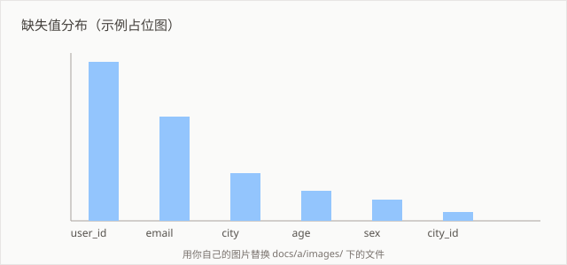

# 数据清洗实录

## 缺失值处理

先看清缺失的规模，再决定策略。



上图用 `isnull().mean()` 逐列统计。可以看到 `user_id` 和 `email` 的缺失率明显高于其他列——这类列大概率是"可选填写"，直接填充意义不大。

```python
import pandas as pd

df = pd.read_csv("raw.csv")

# 按阈值分列处理：缺失率高的直接丢弃，其余填充
threshold = 0.3
high_missing = df.columns[df.isnull().mean() > threshold]

df = df.drop(columns=high_missing)
df = df.fillna(df.median(numeric_only=True))
```

## 重复值

```sql
-- 先看重复量级，再决定保留哪条
SELECT user_id, COUNT(*) AS cnt
FROM events
GROUP BY user_id
HAVING cnt > 1
ORDER BY cnt DESC;
```

保留策略：按业务时间取最新一条。

```sql
DELETE FROM events e
WHERE e.rowid NOT IN (
    SELECT rowid FROM (
        SELECT rowid,
               ROW_NUMBER() OVER (
                   PARTITION BY user_id ORDER BY created_at DESC
               ) AS rn
        FROM events
    ) t WHERE t.rn = 1
);
```

## 常见坑

1. **时间列被读成字符串**。pandas 默认推断，遇到 `2026/10/09` 这种格式会得到 object dtype。
   ```python
   df["dt"] = pd.to_datetime(df["dt"], format="%Y/%m/%d", errors="coerce")
   df[df["dt"].isna()]
   ```
   `errors="coerce"` 把解析失败的置为 NaT，然后立刻筛出来看。直接 `errors="ignore"` 在 pandas 2.x 已废弃。

2. **pandas 2.x 的 `inplace` 行为变化**。链式赋值 `df[df.x > 1]["y"] = 2` 会报 `SettingWithCopyWarning`，改用 `.loc`。

3. **合并后行数暴涨**。`merge` 之前先检查右表的键是否唯一：
   ```python
   assert right["key"].is_unique, "右表 key 不唯一，merge 会产生笛卡尔积"
   ```
