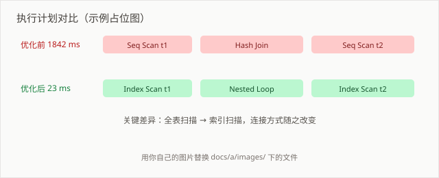

# SQL 片段备忘

> 以下均为 PostgreSQL 方言。MySQL 里 `IS DISTINCT FROM`、`FULL OUTER JOIN`、`EXPLAIN ANALYZE` 都不成立。

## 窗口函数

### 同比 / 环比

```sql
SELECT
    month,
    amount,
    LAG(amount, 12) OVER (ORDER BY month)                AS yoy_base,
    LAG(amount, 1)  OVER (ORDER BY month)                AS mom_base,
    -- amount 是整数列时必须 cast：PG 里 int / int 是整数除法，
    -- 不 cast 的话同比值会被截断成 0，看着全变成 -100%
    amount::numeric / NULLIF(LAG(amount, 12) OVER (ORDER BY month), 0) - 1 AS yoy
FROM monthly_sales;
```

`NULLIF(..., 0)` 挡分母为零；`::numeric` 挡整数除法。MySQL 的 `/` 本身就返回浮点数，所以本地跑得好好的，换 PG 才发现同比全是 0——这个坑很难联想到是除法规则不一样。

### 组内累计

```sql
SELECT
    dt,
    user_id,
    amount,
    SUM(amount) OVER (
        PARTITION BY user_id
        ORDER BY dt
        ROWS BETWEEN UNBOUNDED PRECEDING AND CURRENT ROW
    ) AS cum_amount
FROM orders;
```

`ORDER BY` 后不写 `ROWS` 帧的话，默认是 `RANGE BETWEEN UNBOUNDED PRECEDING AND CURRENT ROW`。同一 `dt` 有多行时，`RANGE` 会把同一天的行合并计算——这通常不是你想要的。**涉及累计求和时显式写 `ROWS`。**

## 排查类

### 找出数量对不上的维度

```sql
SELECT
    a.user_id,
    a.cnt AS left_cnt,
    b.cnt AS right_cnt
FROM (SELECT user_id, COUNT(*) cnt FROM t1 GROUP BY user_id) a
FULL OUTER JOIN (SELECT user_id, COUNT(*) cnt FROM t2 GROUP BY user_id) b
  ON a.user_id = b.user_id
WHERE a.cnt IS DISTINCT FROM b.cnt;
```

`IS DISTINCT FROM` 比 `a.cnt <> b.cnt` 强的地方：能正确处理 NULL。`NULL <> 1` 结果是 NULL，会被 WHERE 过滤掉，导致差异行漏检。这个错误非常隐蔽。

### 执行计划

```sql
EXPLAIN ANALYZE
SELECT ...;
```

关注 `actual time` 而不是 `cost`。`cost` 是优化器的估算值，偏差大说明统计信息过期——先 `ANALYZE 表名`，再重看。

## 性能

- 过滤条件尽早下推，别在子查询里先 `SELECT *` 再 `WHERE`
- `JOIN` 的关联列都建索引
- 大表分区 + 分区裁剪，确认 `WHERE` 里带了分区键



上图是优化前后的执行计划对比，左边全表扫描 + Hash Join，右边走了索引扫描，实际耗时差了两个数量级。
