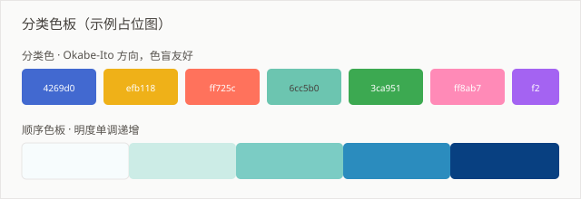

# 可视化规范

## 颜色

### 涨跌配色

面向国内读者、财务和股票相关场景，一律遵循：

| 方向 | 颜色 | 色值 |
|------|------|------|
| 上涨 / 正向 | 红 | `#E24B4A` |
| 下跌 / 负向 | 绿 | `#1D9E75` |

这与欧美市场惯例相反，不要混用。

### 分类色板

色盲友好（viridis / Okabe-Ito 方向），顺序排列时明度单调递增：

```python
PALETTE = [
    "#4269d0", "#efb118", "#ff725c",
    "#6cc5b0", "#3ca951", "#ff8ab7", "#a463f2",
]

SEQUENTIAL = ["#f7fcfd", "#ccece6", "#7bccc4", "#2b8cbe", "#084081"]
```

## 图表选型

| 想表达 | 用什么 | 别用 |
|--------|--------|------|
| 随时间变化的趋势 | 折线图 | 饼图 |
| 类别间比较 | 横向条形图 | 竖向条形图（标签会挤） |
| 两个变量的关联 | 散点图 | 双轴折线 |
| 构成占比 | 堆叠条形图 | 多层饼图 |
| 分布 | 直方图 / 箱线图 | 折线图 |

类别数超过 20 个时，横向条形图按值排序；不要按原始顺序排——那样读者要靠眼睛来回比对长度。



## 标注原则

- **不用 3D**，透视变形会扭曲面积比，读者对长度的判断被破坏。
- **不用双 Y 轴**，两个轴的缩放可以任意调整，等于让任何结论都"成立"。
- 网格线只保留水平方向，颜色 `#e7e5e4` 以下。
- 数据标签只在关键点标注，全标就等于没标。
- 直接在图上标结论（"Q3 环比 +18%"），比让读者去算更有效。

## 尺寸

```python
import matplotlib.pyplot as plt

plt.rcParams.update({
    "figure.dpi": 144,      # 屏幕展示，144 足够；印刷才需要 300
    "font.size": 11,
    "axes.spines.top": False,
    "axes.spines.right": False,
    "figure.autolayout": True,
})

fig, ax = plt.subplots(figsize=(8, 4.5))
```

中文乱码处理：

```python
plt.rcParams["font.sans-serif"] = ["Microsoft YaHei", "PingFang SC", "SimHei"]
plt.rcParams["axes.unicode_minus"] = False   # 负号必须单独设置，否则显示为方块
```

`axes.unicode_minus` 那一行极易遗漏——负号变成方块而正文字体正常，导致很多人误以为字体问题。
